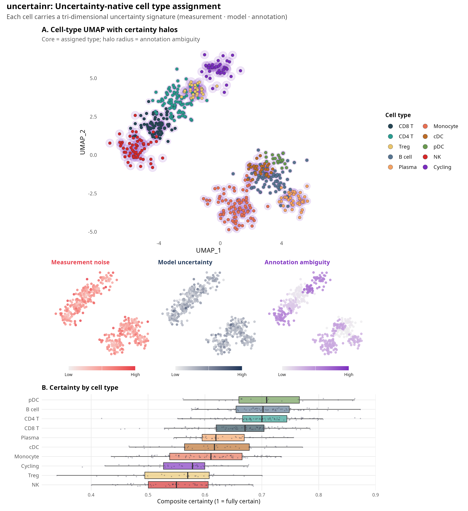
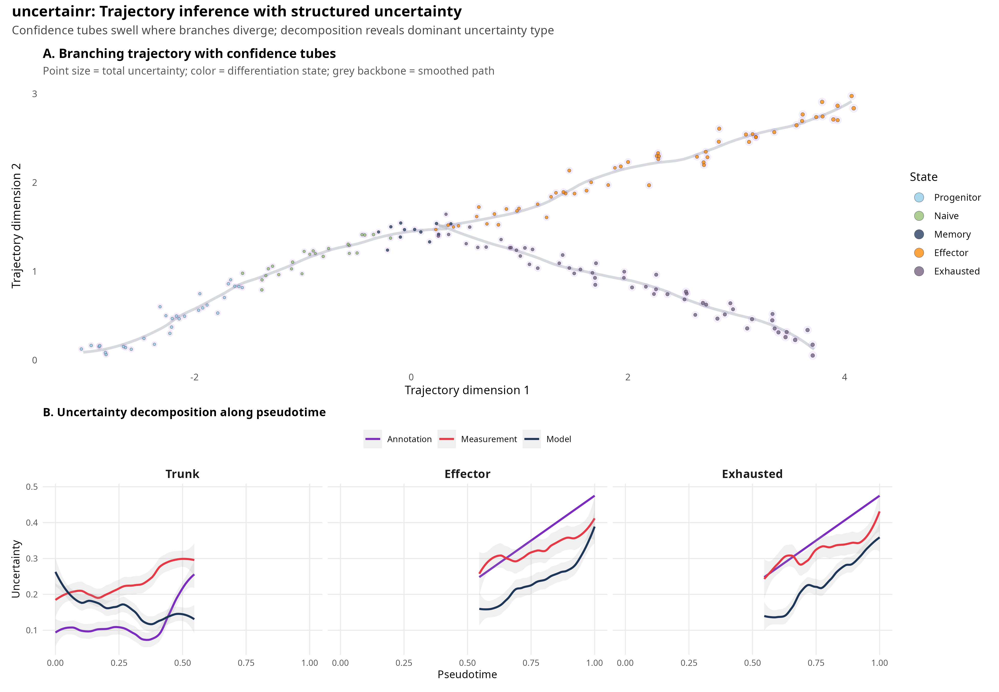
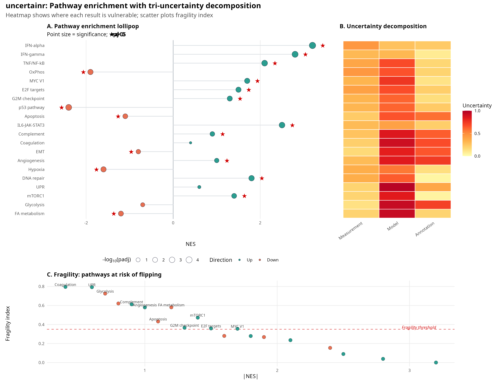

# (PART) Uncertainty, provenance, scale {-}

# uncertainr — uncertainty as a first-class channel {#uncertainr}

## Concept

In conventional bioinformatics figures, uncertainty is a side annotation:
an error bar, a transparent point, a supplementary table, an asterisk. Yet
the questions a reader most wants to answer are exactly the ones that get
buried:

- How certain is this result?
- *Where* is the uncertainty located?
- What *type* of uncertainty is present?
- How does uncertainty change interpretation?

`uncertainr` re-encodes uncertainty as a primary visual channel by
decomposing it into three independent dimensions and rendering each as a
distinct halo or fill on the same atomic glyph (a *certainty card*).

The three dimensions are:

1. **Measurement noise** — sequencing depth, dropout rate, read coverage.
2. **Model uncertainty** — posterior variance, bootstrap SD, ensemble
   disagreement.
3. **Annotation ambiguity** — label entropy, multi-mapping, marker overlap.

A high-confidence cell looks crisp; a cell whose label is uncertain
because the model disagrees looks visually different from a cell whose
label is uncertain because the assay is noisy.

## Figures

```{r echo=FALSE, fig.cap="Cell-type UMAP with tri-channel certainty halos."}

```

```{r echo=FALSE, fig.cap="Branching trajectory with confidence tubes that narrow with temporal distance."}

```

```{r echo=FALSE, fig.cap="Pathway enrichment with decomposed uncertainty heatmap and fragility scatter."}

```

## API

```{r eval=FALSE}
source("packages/uncertainr/R/uncertainr.R")

# data
uncertainr_celltype_data()      # synthetic UMAP with three uncertainty channels
uncertainr_trajectory_data()    # branching pseudotime
uncertainr_pathway_data()       # GSEA-like with uncertainty per term

# plots
uncertainr_plot_celltype_umap()
uncertainr_plot_trajectory()
uncertainr_plot_pathway()

# render the curated figure set
uncertainr_save_demo("figures/")
```

The palette helpers `uncertainr_celltype_palette()` and
`uncertainr_unc_scales()` are exported so external code can reuse the
exact colour mappings.

## Worked example

The minimal recipe for a single certainty card:

```{r eval=FALSE}
library(ggplot2)
library(patchwork)
source("R/bioviz-common.R")
source("packages/uncertainr/R/uncertainr.R")

d <- uncertainr_celltype_data()
ggplot(d, aes(UMAP_1, UMAP_2)) +
  geom_point(aes(color = celltype, alpha = 1 - model_uncertainty), size = 1.2) +
  geom_point(data = subset(d, annotation_ambiguity > 0.5),
             shape = 1, size = 2.6, stroke = 0.6, color = "#7b2cbf") +
  scale_color_manual(values = uncertainr_celltype_palette()) +
  bioviz_theme_void() +
  labs(title = "Cells circled = ambiguous label")
```

::: design-notes
**Design notes.**
- Do **not** combine uncertainty channels into a single scalar score for
  display — the entire point is decomposition.
- Cells in the bottom-density 5 % should always remain visible at hero
  size; rare populations are where readers most want to inspect uncertainty.
- The fragility panel of `uncertainr_plot_pathway()` is the only place
  where significance and uncertainty are crossed; treat it as a diagnostic,
  not as a primary statistical claim.
:::
