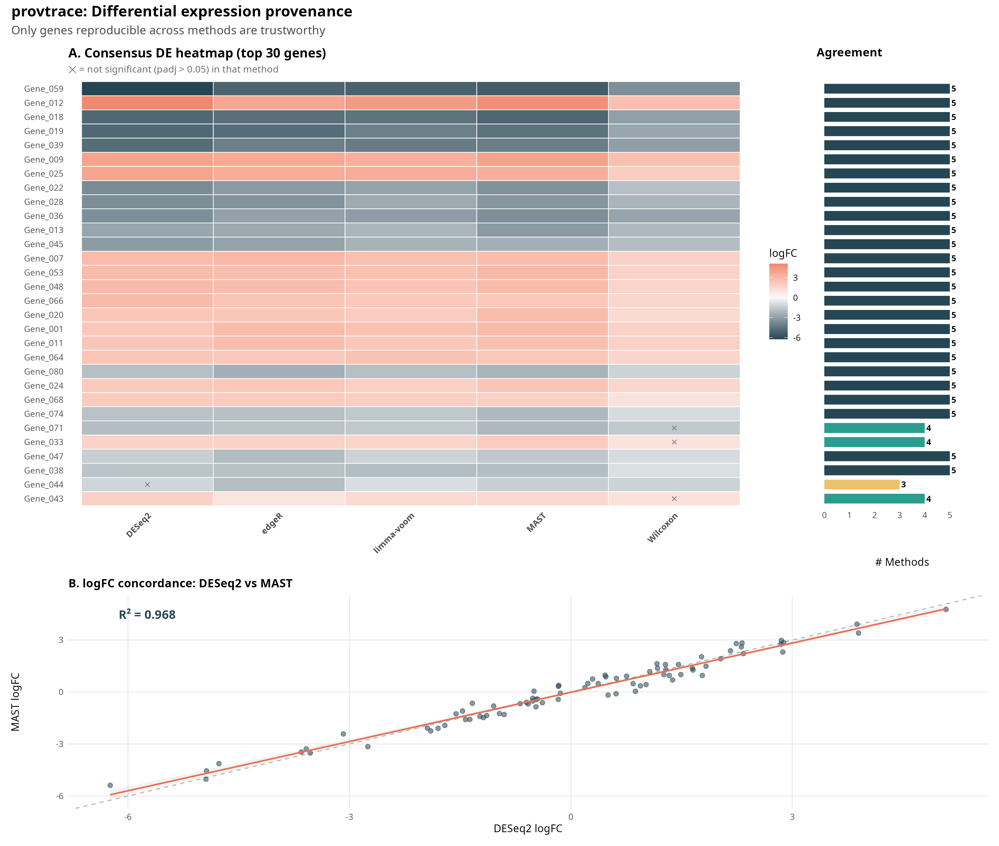
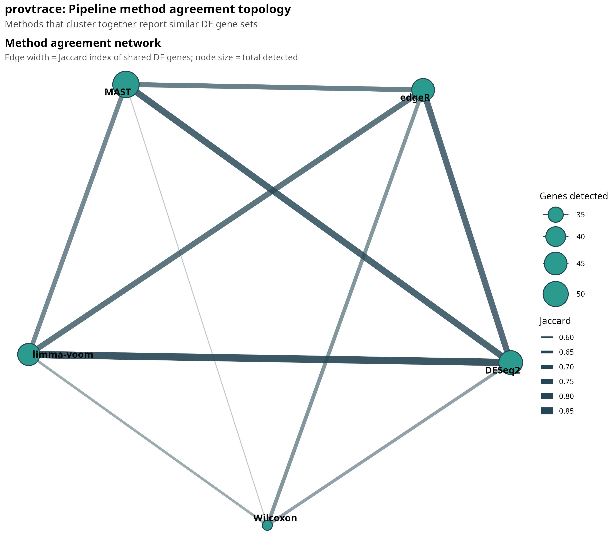

# provtrace — provenance inside the figure {#provtrace}

## Concept

A bioinformatics result is only meaningful in the context of how it was
produced. Differential expression depends on normalisation; clustering
depends on resolution; CNV calls depend on the segmentation method; peak
calls depend on the q-value threshold. Conventional figures hide all of
this in a methods paragraph.

`provtrace` integrates provenance into the figure itself. The user does
not just see *what* result was obtained, but *which transformations
materially shaped it*. Pipeline-fragile results are made visually distinct
from pipeline-robust ones.

## Figures

```{r echo=FALSE, fig.cap="DE result + provenance trace: top genes annotated with the methods that recovered them and a fragility score."}

```

```{r echo=FALSE, fig.cap="Method-agreement network: nodes = pipeline variants, edges = result similarity."}

```

The clustering provenance figure was retired from the curated set in v0.2
because stacked-bar provenance does not survive the *information density*
test (chapter \@ref(composing-figures)).

## API

```{r eval=FALSE}
source("packages/provtrace/R/provtrace.R")

provtrace_de_data()                 # DE result × pipeline variant
provtrace_agreement_data()          # method × method similarity matrix
provtrace_plot_de()                 # primary panel
provtrace_plot_agreement_net()      # supporting panel
provtrace_save_demo("figures/")
```

## Worked example

A minimal DE-with-provenance plot:

```{r eval=FALSE}
source("packages/provtrace/R/provtrace.R")
df <- provtrace_de_data()
provtrace_plot_de()
```

Each gene is rendered as a *trace* across pipeline variants; vertical
spread = fragility, horizontal position = consensus rank.

::: design-notes
**Design notes.**
- Provenance ribbons must not dominate the biological result. Default to
  ribbons in muted greys; reserve saturated colour for the result itself.
- Fragility scores should be reported alongside the figure, not only in
  legend form. A gene whose top-ranked status flips under three of seven
  pipelines is a different scientific claim than one stable across all
  seven.
- Do not display more than ~7 pipeline variants in a single figure.
  Beyond that, the trace becomes a hairball.
:::
