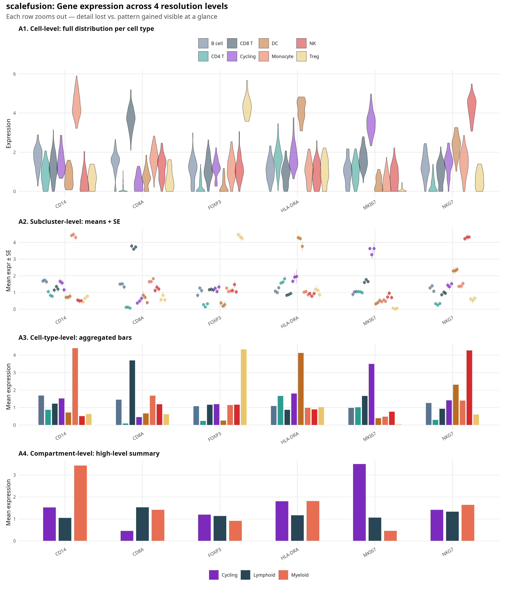
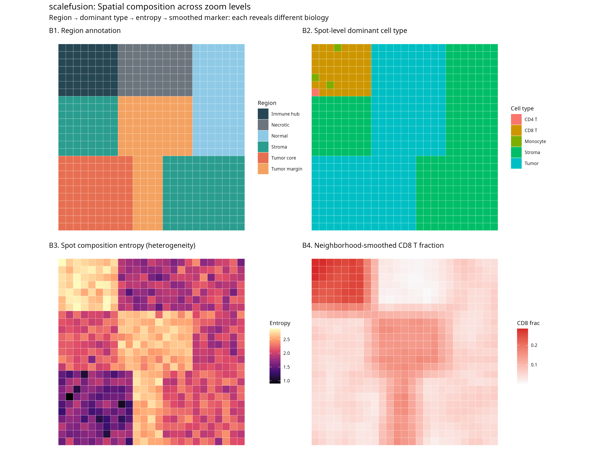

# scalefusion — cross-scale semantic continuity {#scalefusion}

## Concept

Bioinformatics is multi-scale by nature: variant → gene → pathway →
phenotype, or cell → cell-type → tissue compartment → patient. Conventional
dashboards link panels at different scales but force the reader to switch
visual encodings between them, breaking the sense of continuity.

`scalefusion` keeps the encoding semantically continuous as the user moves
across scales. The visual mark for a gene at single-cell resolution is the
same mark, smoothly aggregated, at compartment resolution; the user sees
*the same object* getting coarser, not a different object entirely.

## Figures

```{r echo=FALSE, fig.cap="Expression ladder: the same panel of marker genes shown at four resolutions, anchored vertically so the reader can trace each gene across scales."}

```

```{r echo=FALSE, fig.cap="Spatial scale ladder: tissue regions at progressively coarser resolution preserving spatial registration."}

```

The cross-scale disagreement panel was retired in v0.2 because a paired
bar chart is not a strong enough mark for the disagreement claim it makes.
A future revision will replace it with a per-gene scale-sensitivity index.

## API

```{r eval=FALSE}
source("packages/scalefusion/R/scalefusion.R")

scalefusion_expr_data()
scalefusion_spatial_data()

scalefusion_plot_expr()             # ladder of cell → celltype → compartment
scalefusion_plot_spatial()          # spatial counterpart

scalefusion_save_demo("figures/")
```

## Worked example

```{r eval=FALSE}
source("packages/scalefusion/R/scalefusion.R")
scalefusion_plot_expr()
```

::: design-notes
**Design notes.**
- The same gene must occupy the same row across all resolutions; vertical
  anchoring is the entire point.
- Aggregation is information loss. Do not show aggregated panels without
  also showing the disaggregated counterpart, even if briefly.
- Resist the temptation to add a fifth resolution. Four is already at the
  limit of what a reader can hold in working memory.
:::
