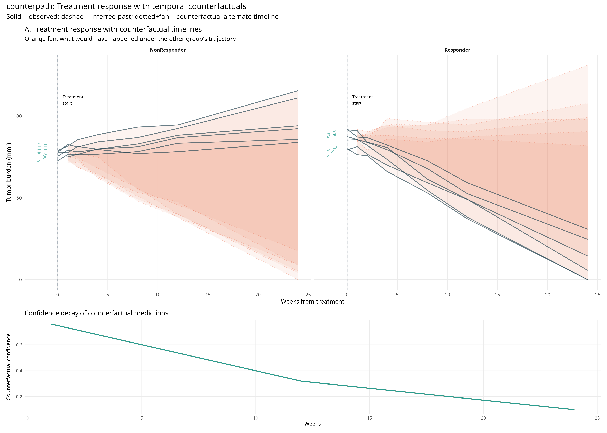
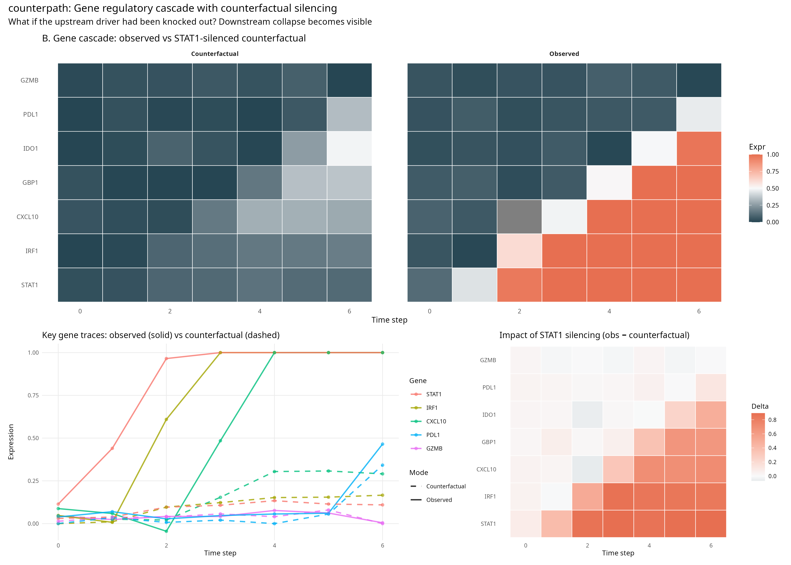
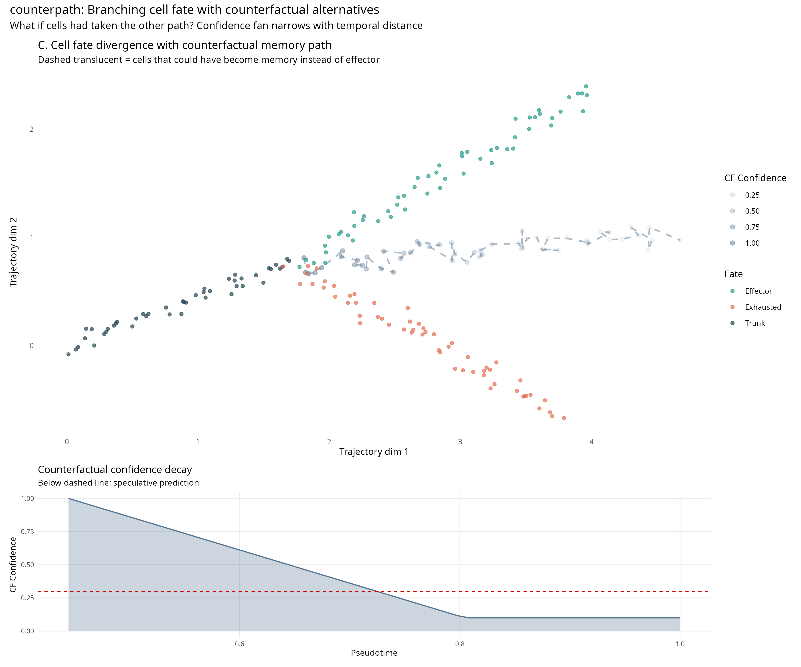

# (PART) Dynamics, interaction, topology {-}

# counterpath — counterfactual trajectories {#counterpath}

## Concept

Trajectory inference answers: *given the cells we observed, what is the
ordering?* `counterpath` answers a different question: *what would have
happened to these cells under an alternative intervention?*

The visual grammar is a confidence fan: the observed trajectory is a
crisp solid path; the counterfactual is a dashed translucent path that
narrows as time progresses, encoding the fact that counterfactual claims
become increasingly speculative the further from the intervention point.

## Figures

```{r echo=FALSE, fig.cap="Treatment-response trajectory with counterfactual fan."}

```

```{r echo=FALSE, fig.cap="Cascade of cell-state transitions with confidence ribbons."}

```

```{r echo=FALSE, fig.cap="Branching cell fate with counterfactual memory path."}

```

## API

```{r eval=FALSE}
source("packages/counterpath/R/counterpath.R")

counterpath_treatment_data()
counterpath_cascade_data()
counterpath_fate_data()

counterpath_plot_treatment()
counterpath_plot_cascade()
counterpath_plot_fate()

counterpath_save_demo("figures/")
```

## Worked example

```{r eval=FALSE}
source("packages/counterpath/R/counterpath.R")
counterpath_plot_fate()
```

::: design-notes
**Design notes.**
- Counterfactual paths must visually *recede*; a dashed translucent
  geometry is the minimum.
- A confidence fan that does not narrow with time is misleading. Make
  uncertainty grow with extrapolation distance.
- Do not show counterfactual claims without an accompanying confidence
  decay plot.
:::
