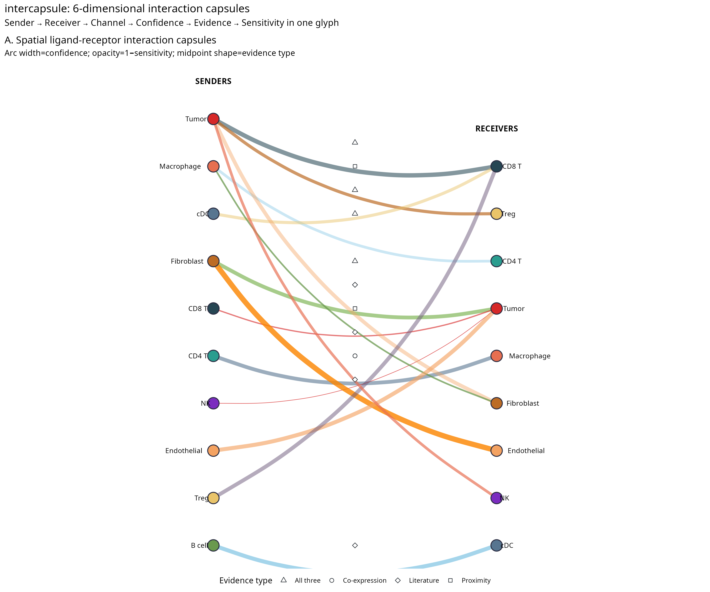
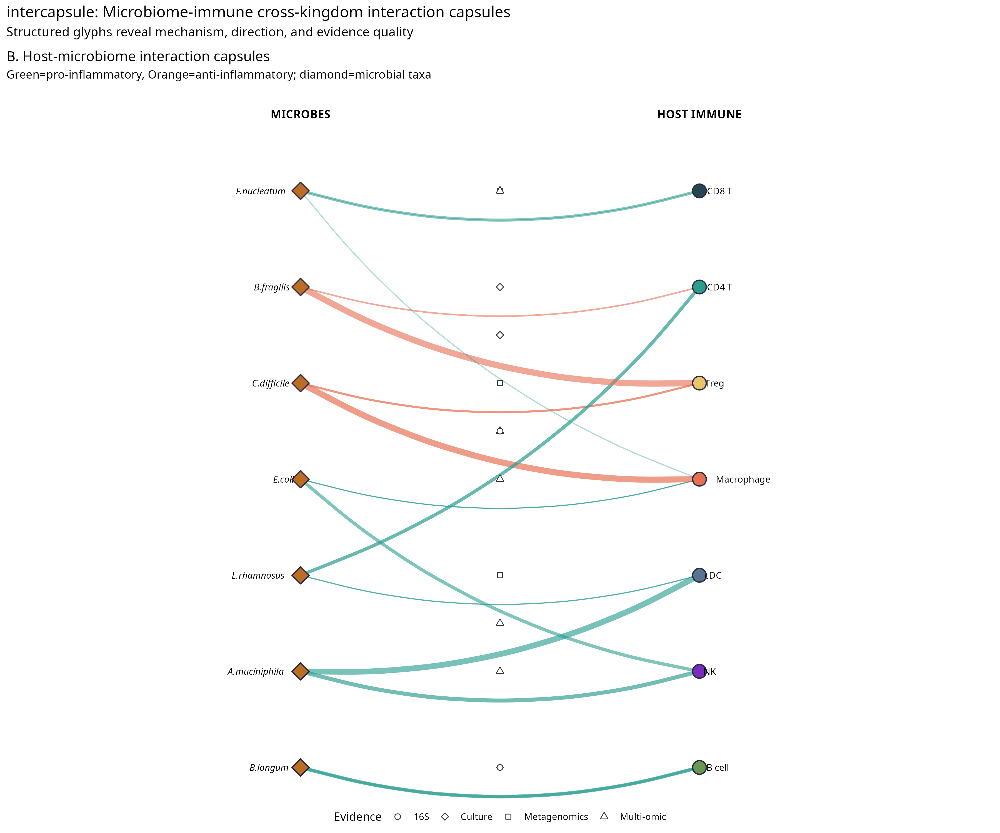

# intercapsule — interaction-first capsule glyphs {#intercapsule}

## Concept

Cell–cell interaction plots are usually one of two things: a chord diagram
(pretty, hard to read), or a heatmap of ligand–receptor pairs (readable,
boring). Both reduce the interaction to a single scalar.

`intercapsule` renders each interaction as a structured *capsule glyph*
that carries multiple channels at once:

- mechanism (the ligand–receptor pair),
- direction (sender → receiver),
- magnitude (capsule length),
- confidence (capsule opacity / outline),
- evidence type (capsule fill pattern).

The result is denser per pixel than either chord or heatmap, while still
discoverable at a glance.

## Figures

```{r echo=FALSE, fig.cap="Spatial L-R interactions rendered as capsule glyphs over a tumor-stroma section."}

```

```{r echo=FALSE, fig.cap="Microbiome–immune cross-kingdom capsules with evidence-type marks."}

```

The condition-comparison heatmap from v0.1 was retired in v0.2 because it
no longer used the capsule encoding (it had degenerated into a regular
heatmap with a delta panel).

## API

```{r eval=FALSE}
source("packages/intercapsule/R/intercapsule.R")

intercapsule_spatial_data()
intercapsule_microbiome_data()

intercapsule_plot_spatial()
intercapsule_plot_microbiome()

intercapsule_save_demo("figures/")
```

::: design-notes
**Design notes.**
- A capsule with five channels is at the limit of what a reader can
  decode in one glance; do not add a sixth.
- Bundling is essential when there are more than ~30 capsules; without
  it the figure becomes a hairball.
- Capsules must always show direction. Symmetric edges should use a
  different mark.
:::
