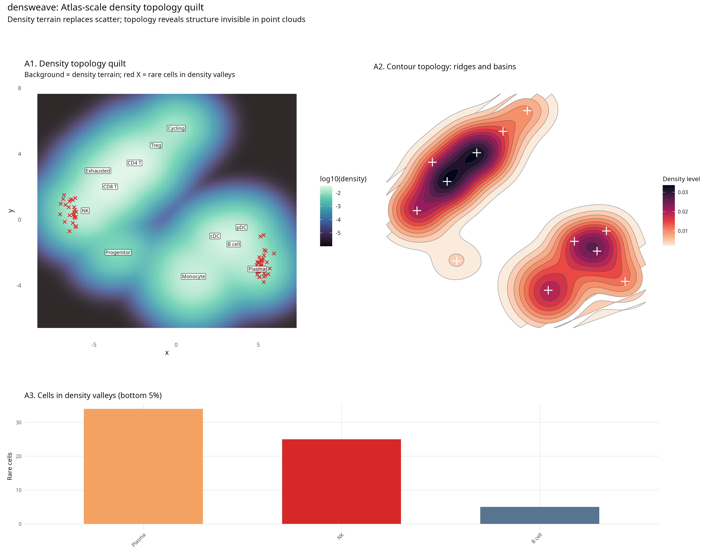
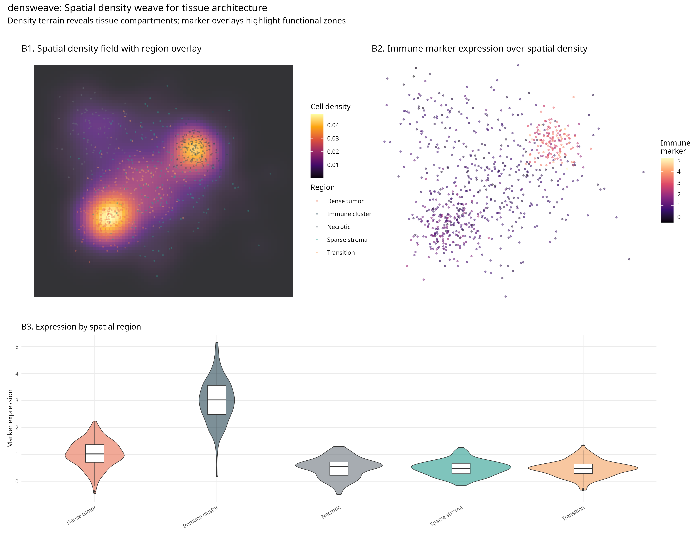

# densweave — density-first topology {#densweave}

## Concept

A scatter plot of an embedding answers "where are the cells?" A *density
quilt* answers "what is the topology of the manifold?" `densweave`
replaces the primary visual mark from "point" to "density terrain" so that
ridges, valleys, saddles, and rare populations become primary, not
secondary, features of the figure.

The scatter has not disappeared; it is overlaid as a sparse glyph layer
showing only the cells that fall in density valleys (the rare events the
density mode would otherwise hide).

## Figures

```{r echo=FALSE, fig.cap="Atlas-scale density topology quilt with rare-cell callouts and a contour-only companion view."}

```

```{r echo=FALSE, fig.cap="Spatial density weave: tissue regions exposed by density, with marker overlay."}

```

The pre/post comparison panel from v0.1 was retired in v0.2; the delta
panel alone carries the comparison claim, and the side-by-side density
panels duplicated the primary atlas figure.

## API

```{r eval=FALSE}
source("packages/densweave/R/densweave.R")

densweave_atlas_data()
densweave_spatial_data()
densweave_density_grid()      # helper: 2D KDE on a regular grid
densweave_ct_pal()            # canonical 30-colour atlas palette

densweave_plot_atlas()
densweave_plot_spatial()

densweave_save_demo("figures/")
```

## Worked example

```{r eval=FALSE}
source("packages/densweave/R/densweave.R")

d <- densweave_atlas_data()
dg <- densweave_density_grid(d$UMAP_1, d$UMAP_2, n = 100)

ggplot() +
  geom_tile(data = dg, aes(x, y, fill = log10(density + 1e-6))) +
  scale_fill_viridis_c(option = "mako") +
  coord_equal() + glyphome_theme_void() +
  labs(title = "Density terrain")
```

::: design-notes
**Design notes.**
- Density terrain must be the *primary* mark, with points overlaid only
  for rare-event callouts. Do not invert the visual hierarchy.
- Use a perceptually uniform colour scale (mako, viridis); avoid the
  default rainbow.
- The rare-cell threshold should be reported (e.g. "bottom 5 %") and is
  itself a hyperparameter — record it in the figure caption.
:::
