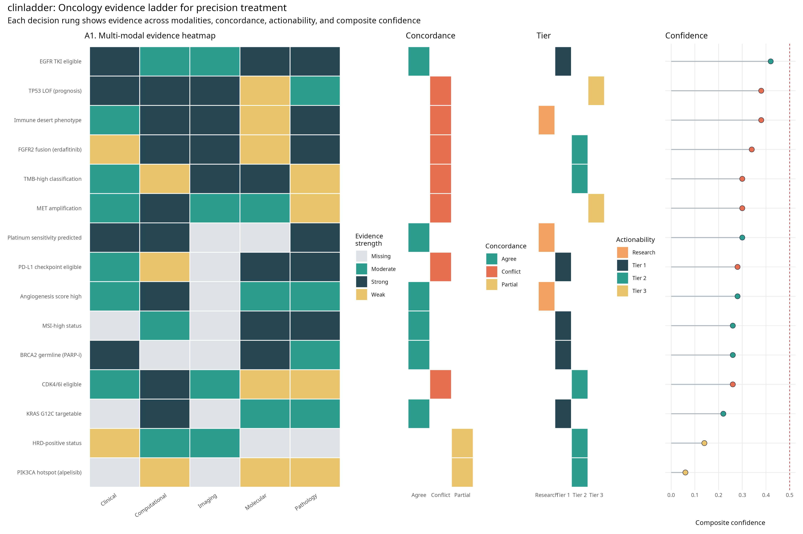
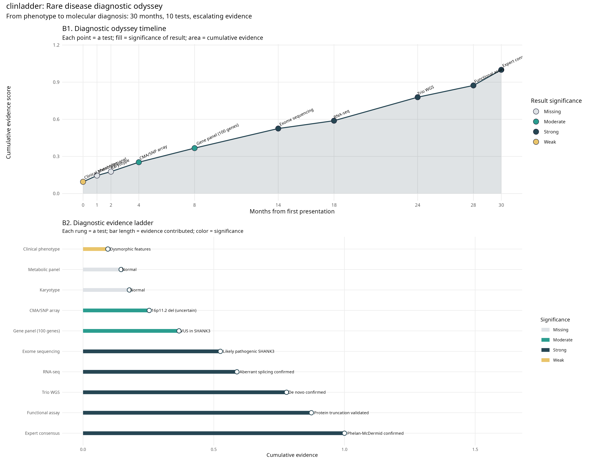
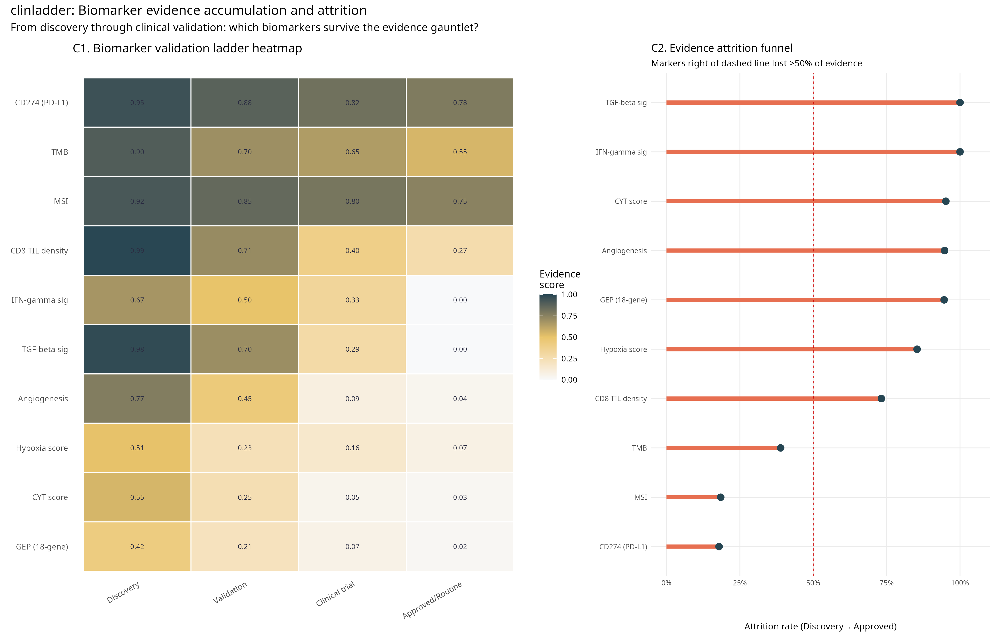

# (PART) Clinical decision suite {-}

# clinladder — evidence ladders for clinical genomics {#clinladder}

## Concept

A tumour-board figure has to communicate, in seconds, a decision-relevant
synthesis of variants, expression signatures, pathway evidence, prior
treatment, and clinical context. OncoPrint solves part of this; expression
heatmaps solve another part; signature ribbons solve a third. None solve
the whole problem.

`clinladder` renders the full evidence stack as a vertical *ladder*: each
rung is a decision-relevant evidence track, with patients on the x-axis
and a final actionability rung at the top.

## Figures

```{r echo=FALSE, fig.cap="Oncology tumor-board ladder: variants, signatures, and actionability."}

```

```{r echo=FALSE, fig.cap="Rare-disease diagnostic ladder integrating phenotypes, candidate variants, and inheritance evidence."}

```

```{r echo=FALSE, fig.cap="Biomarker review ladder: assay panel, signal strength, prior evidence, recommendation."}

```

## API

```{r eval=FALSE}
source("packages/clinladder/R/clinladder.R")

clinladder_onco_data()
clinladder_rare_disease_data()
clinladder_biomarker_data()

clinladder_plot_onco()
clinladder_plot_rare_disease()
clinladder_plot_biomarker()

clinladder_save_demo("figures/")
```

::: design-notes
**Design notes.**
- The actionability rung is always last. It is the answer to "so what?"
- Each rung must be readable without the others. A figure that requires
  cross-referencing every rung to be interpreted has failed.
- Use no more than seven rungs. Beyond that, working memory breaks.
:::
