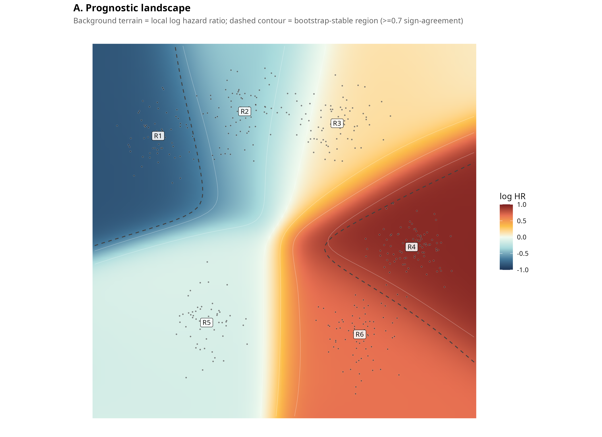
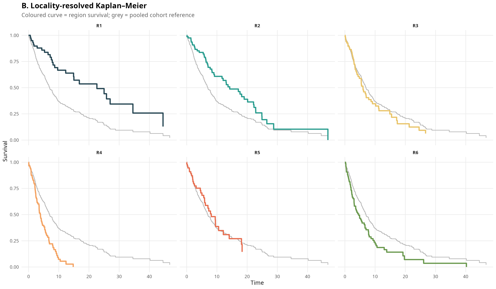
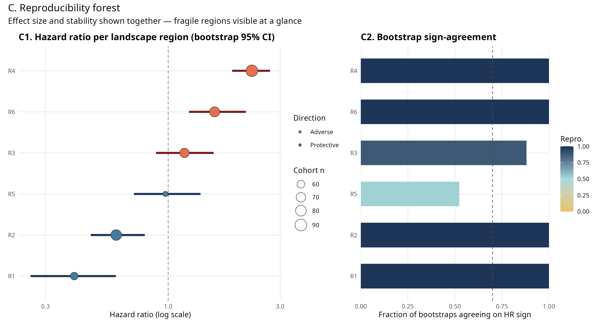

# survivora — prognostic landscape cartography {#survivora}

## Concept

Conventional survival figures compartmentalise: a Kaplan–Meier curve here,
a forest plot there, a UMAP somewhere else. None of them say *where on the
embedding the prognosis is robust* — and that is the most decision-relevant
question in molecular subtyping.

`survivora` treats hazard as a topographic surface over the embedding.
Bootstrap stability is rendered as contours: areas where the prognostic
signal survives resampling. Locality-resolved KM curves are then small
multiples that drill into specific landscape regions.

## Figures

```{r echo=FALSE, fig.cap="Hazard-ratio terrain over the embedding, with bootstrap stability contours."}

```

```{r echo=FALSE, fig.cap="Locality-resolved KM curves, one per landscape region."}

```

```{r echo=FALSE, fig.cap="Per-region hazard-ratio forest with bootstrap CI and reproducibility score."}

```

## API

```{r eval=FALSE}
source("packages/survivora/R/survivora.R")

survivora_landscape_data()
survivora_locality_data()
survivora_repro_data()

survivora_plot_landscape()
survivora_plot_locality_km()
survivora_plot_repro_forest()

survivora_save_demo("figures/")
```

::: design-notes
**Design notes.**
- Hazard terrain is meaningful only with stability contours. A
  hazard-only landscape is over-claiming.
- KM small multiples must always show the pooled cohort reference curve
  in grey, otherwise locality looks deceptively strong.
- Forest plots should use bootstrap CI, not Wald CI from a single fit.
:::
