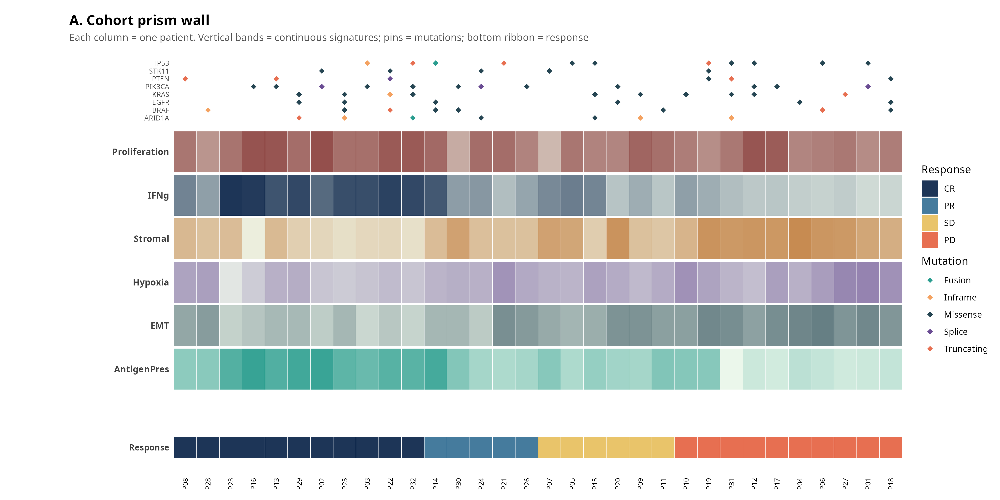
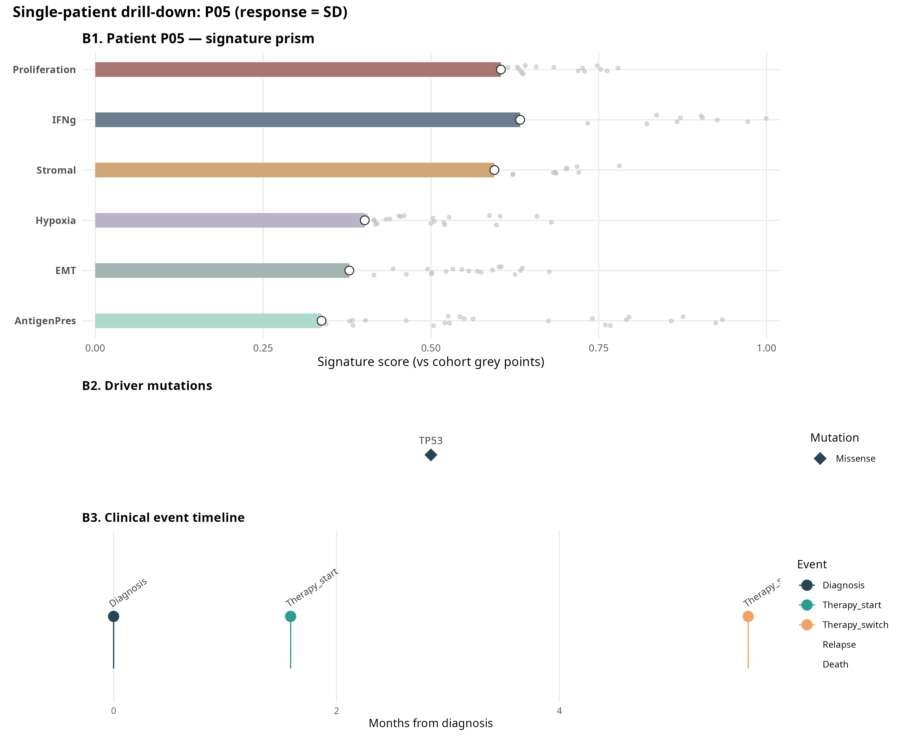
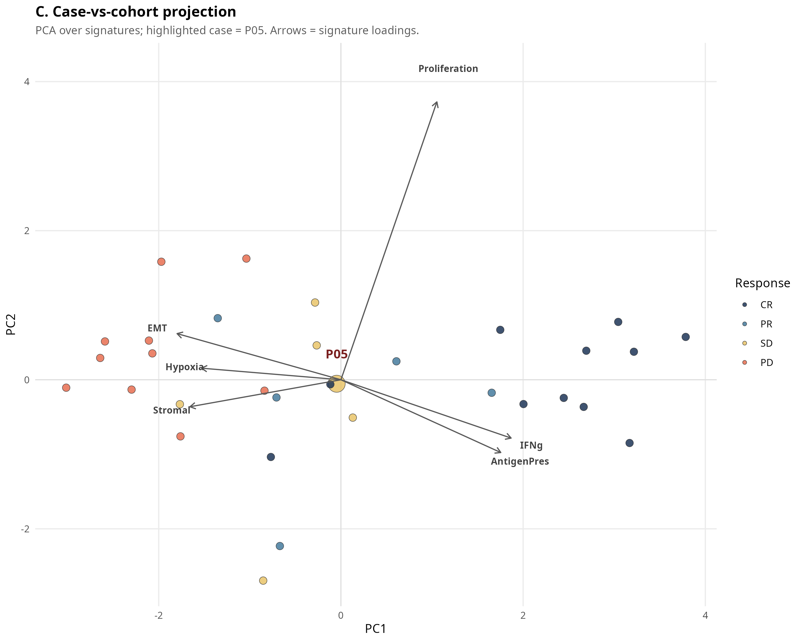

# cohortprism — spectral patient prisms {#cohortprism}

## Concept

OncoPrint's discrete grid was a major step forward, but for modern
multi-omic clinical cohorts it is now the limiting factor: continuous
signature scores cannot be encoded as ticks, and clinical events have no
natural lane in the matrix.

`cohortprism` renders each patient as a vertical multi-band *prism*:

- continuous bands (signature scores, methylation, immune deconvolution),
- discrete tick rows (mutations, fusions, CNVs),
- a temporal lane below for clinical events (treatment, response, follow-up).

Patients are ordered by molecular similarity, with a response ribbon at
the top so the reader can scan for outcome–molecular concordance.

## Figures

```{r echo=FALSE, fig.cap="Cohort prism wall ordered by signature similarity."}

```

```{r echo=FALSE, fig.cap="Single-patient drill-down with annotated clinical events."}

```

```{r echo=FALSE, fig.cap="Cohort PCA projection with the indexed case highlighted."}

```

## API

```{r eval=FALSE}
source("packages/cohortprism/R/cohortprism.R")

cohortprism_cohort_data()
cohortprism_single_data()
cohortprism_projection_data()

cohortprism_plot_wall()
cohortprism_plot_single()
cohortprism_plot_projection()

cohortprism_save_demo("figures/")
```

::: design-notes
**Design notes.**
- Patient ordering is part of the figure's argument. State the ordering
  rule in the caption.
- The temporal lane must use real time on the x-axis, not pseudotime or
  rank.
- A prism with more than ~10 continuous bands becomes unreadable.
  Aggregate, or split into supplement.
:::
