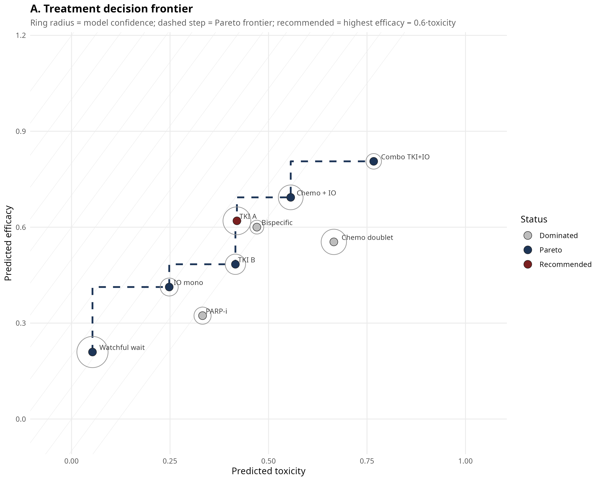
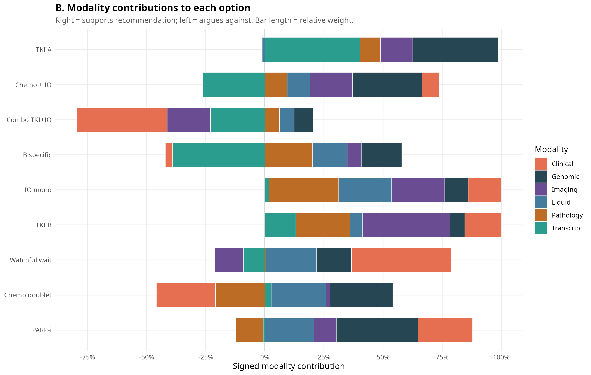
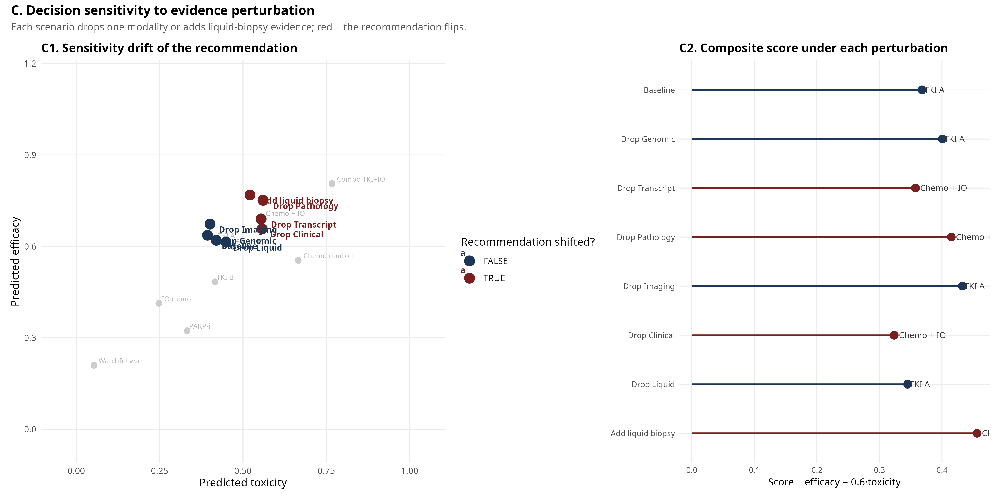

# riskweave — multi-objective decision frontier {#riskweave}

## Concept

A treatment recommendation is a multi-objective optimisation in disguise:
maximise efficacy, minimise toxicity, weight by confidence. Reducing this
to a single ranking discards exactly the trade-off information that makes
the decision useful.

`riskweave` renders the decision *space*. Treatments live on a
two-dimensional efficacy–toxicity plane; confidence is encoded as ring
size; Pareto-dominant treatments are highlighted. A second panel
decomposes each candidate into modality contributions; a third panel
shows how the recommendation drifts when one piece of evidence is
removed.

## Figures

```{r echo=FALSE, fig.cap="Efficacy × toxicity decision frontier with confidence rings."}

```

```{r echo=FALSE, fig.cap="Per-treatment modality-contribution rays."}

```

```{r echo=FALSE, fig.cap="Decision sensitivity to evidence perturbation."}

```

## API

```{r eval=FALSE}
source("packages/riskweave/R/riskweave.R")

riskweave_frontier_data()
riskweave_contributions_data()
riskweave_sensitivity_data()

riskweave_plot_frontier()
riskweave_plot_contributions()
riskweave_plot_sensitivity()

riskweave_save_demo("figures/")
```

::: design-notes
**Design notes.**
- The Pareto frontier must be drawn explicitly. Letting the reader infer
  it defeats the purpose.
- Confidence rings should not encode marginal probabilities directly;
  use a calibrated, human-interpretable mapping (e.g. 50 / 75 / 90 %).
- The sensitivity panel must use the same axis scale as the frontier
  panel so the reader can place perturbed recommendations geometrically.
:::
